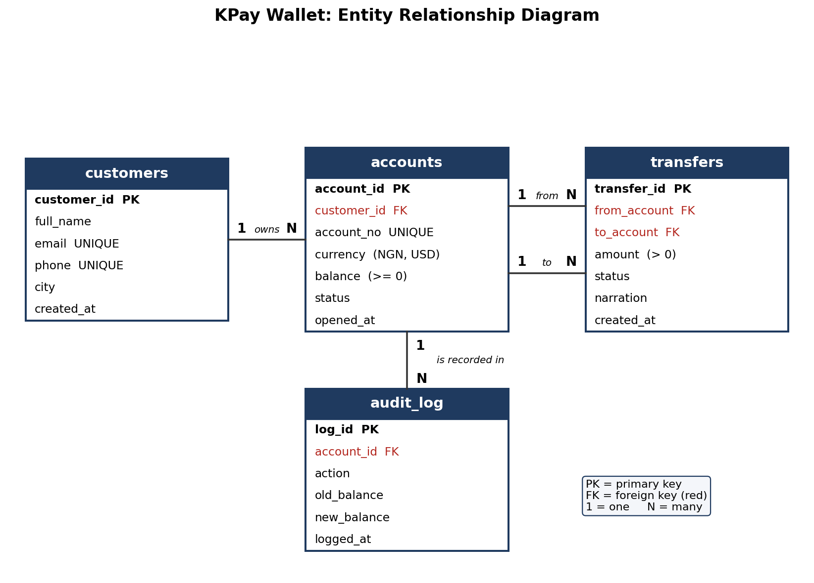

# Portfolio 1: Database Design and Modelling

## Case study: KPay Wallet

KPay Wallet is a fictional digital wallet and money transfer service for Nigerian users. Customers open wallet accounts in naira (NGN) or US dollars (USD) and send money to each other. I picked it because money forces you to be careful. A balance must never drop below zero, and every transfer has to be recorded exactly so it can be traced later. The database would be used by customers on a mobile app, by support staff who handle complaints, and by auditors who check balances.

**Users of the database:** customers (through a mobile app), customer support staff, and auditors who check balances.

**Major data stored:** customer details, wallet accounts in NGN and USD, transfers between accounts, and an audit log of balance changes.

**Key operations:** open an account, send money between accounts, view a statement, reverse a failed transfer, and audit balance changes.

## Files

| File | What it does |
|---|---|
| `01_schema.sql` | Creates the four tables with keys and constraints |
| `02_seed_data.sql` | Fills them with 20,000 customers, 26,666 accounts and 300,000 transfers |
| `er_diagram.png` | Entity relationship diagram |

## ER diagram



## How to run

```
psql -U postgres -c "CREATE DATABASE kpay;"
psql -U postgres -d kpay -f 01_schema.sql
psql -U postgres -d kpay -f 02_seed_data.sql
```

## Design decisions

I used four tables because each one serves a different purpose. The customers table stores customer details, the accounts table keeps track of their accounts, the transfers table records money sent between accounts, and the audit log keeps a history of balance changes.

One customer can have more than one account, for example a naira account and a dollar account, and each account belongs to just one customer. That is what makes the relationship between customers and accounts one-to-many.

The accounts and transfers tables have a one-to-many relationship twice. Whenever money is transferred, there is an account sending the money and another account receiving it. Because of this, the transfers table has two foreign keys that link back to the accounts table. In the diagram, these are shown by the two lines labelled from and to.

I kept the audit log in a separate table so the system can keep track of changes over time. It stores the account, the action, the old balance, the new balance and the time, so when a balance changes the old value is kept in a new row instead of being overwritten. In Portfolio 3 a trigger fills it automatically.

**Constraints.** I added rules to stop mistakes when working with the database. The `balance >= 0` rule stops an account balance from going below zero. The `amount > 0` rule stops transfers with a zero or negative amount. The `from_account <> to_account` rule stops someone transferring money from an account to itself. The `UNIQUE` rule on email, phone number and account number stops duplicates, so customers cannot share an email address or phone number and every account has its own account number. `ON DELETE RESTRICT` stops a customer being deleted while they still have accounts linked to them. Other CHECK rules allow only NGN or USD as a currency and limit the status columns to fixed values. The screenshot `p1_08` shows three examples of the database rejecting operations that break these rules: a negative balance, a transfer from an account to itself and a zero amount.

**Money data type.** I used `NUMERIC(14,2)` to store account balances and transfer amounts because it handles money values accurately to two decimal places. Floating-point types store some decimals only approximately, so adding `0.1` and `0.2` does not give exactly `0.3`. `NUMERIC` keeps the exact value.

## Normalisation

**First normal form (1NF).** Each column holds just one value. For example, if a customer has both a naira account and a dollar account, I don't put both accounts in one cell. Instead, each account has its own row in the accounts table.

**Second normal form (2NF).** Each table has a single column primary key. This means every other column is linked to that key, rather than depending on only part of it, so no column can depend on just part of a combined key.

**Third normal form (3NF).** No column outside the key depends on another column outside the key. For example, a customer's city is stored in the customers table, not repeated in the accounts table. If the customer moves to another city, I only need to update it in one place. If I had copied the city into every account they own, I would have to change several rows, and missing one could leave the database with conflicting information.

**One exception.** I decided to store the current balance directly in the accounts table, even though it could be worked out by adding up all the transfers. Calculating it from scratch every time someone checks their balance would mean reading a lot of rows, and storing it makes it quicker to retrieve. The risk is that the stored balance and the transfers could stop matching. In Portfolio 3, `make_transfer` updates both in one transaction, and a trigger records every balance change in the audit log, so the stored balance can be checked against the history.


## Screenshots

All pictures are in the screenshots folder.

The ER diagram is er_diagram.png in the Portfolio 1 folder, and the numbered screenshots start at p1_02.

| File | What it shows |
|---|---|
| `p1_02_customers_table.png` | The customers table. customer_id is the primary key, email and phone are UNIQUE, and accounts points back to it with ON DELETE RESTRICT. |
| `p1_03_accounts_table.png` | The accounts table. balance is NUMERIC(14,2) with a check that it stays at zero or above, currency allows only NGN or USD, and account_no is UNIQUE. |
| `p1_04_transfers_table.png` | The transfers table. Two foreign keys point to accounts, and checks stop a zero or negative amount and a transfer from an account to itself. |
| `p1_05_seed_counts.png` | The seed script running, then the row counts: 20,000 customers, 26,666 accounts and 300,000 transfers. |
| `p1_06_tables_and_version.png` | The four tables in the database and the PostgreSQL version, 16.15. |
| `p1_07_audit_log_table.png` | The audit_log table. It stores the account, the action, the old balance, the new balance and the time. |
| `p1_08_constraints_rejected.png` | Three bad changes rejected by the database: a balance of -500, a transfer from account 1 to itself and a transfer with an amount of 0. |
