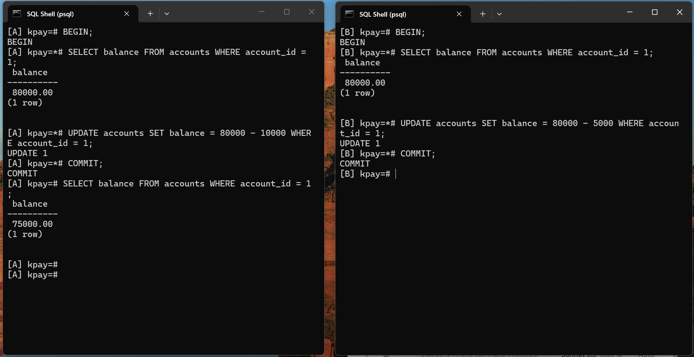
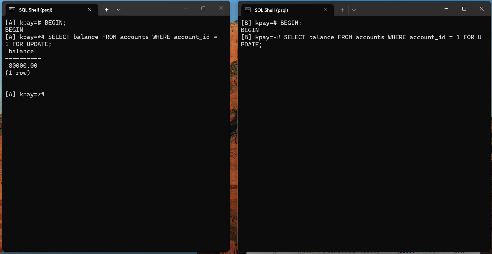
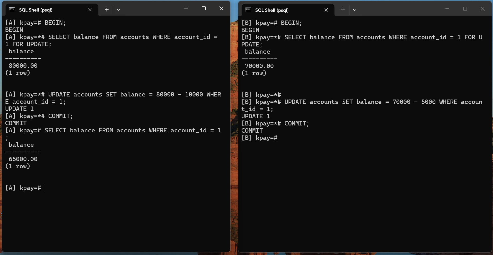
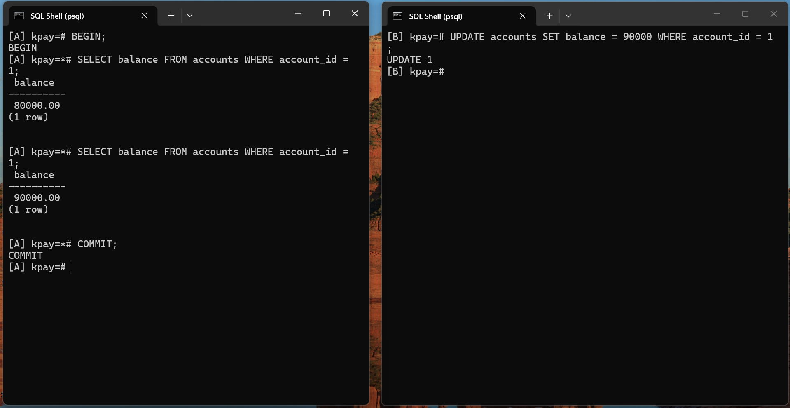
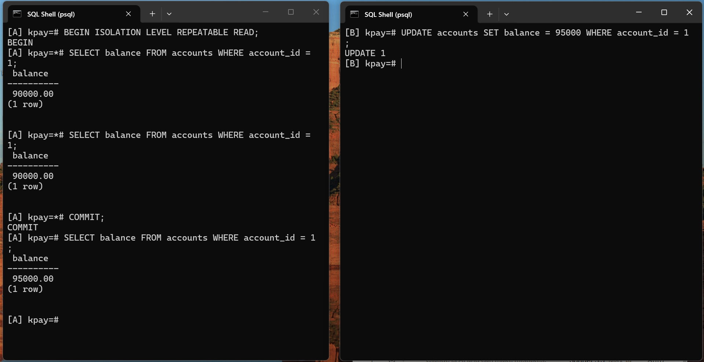
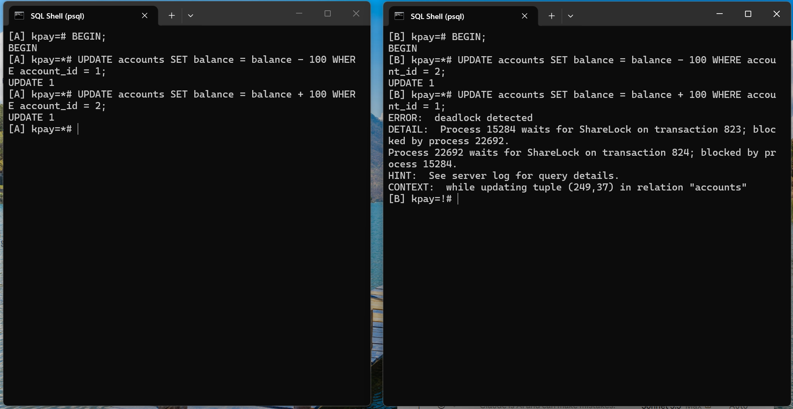
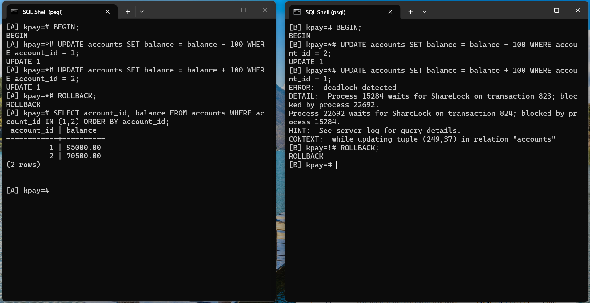

# Portfolio 3, Part B: Concurrency experiments

These four experiments need two psql windows open at the same time. Both connect to the `kpay` database. Call them Session A and Session B. Run the steps in the order shown, one step at a time, and take a screenshot of both windows at the end of each experiment.

The audit trigger from Part A is still active, so every balance change in these experiments is also written to the `audit_log` table.

## Set up the two windows

1. Open SQL Shell (psql) twice.
2. In each window press Enter at Server, type `kpay` at Database, press Enter at Port, press Enter at Username, then type your password.
3. Put the windows side by side so that both fit in one screenshot.

Label the windows so every screenshot shows which session is which. In the first window type:

```
\set PROMPT1 '[A] %/%R%x%# '
```

In the second window type:

```
\set PROMPT1 '[B] %/%R%x%# '
```

The prompt now starts with `[A]` or `[B]`. A `*` after `kpay=` means a transaction is open. A `!` means the transaction has failed, and only `ROLLBACK` will work.

To clear a window between experiments, type `\! cls`.

## Reset before each experiment

Run this in either window. It puts account 1 back on 80000.

```sql
UPDATE accounts SET balance = 80000 WHERE account_id = 1;
```

## Experiment 1: Lost update (the problem)

Two people change the same balance at the same time. Each one reads the old balance, works out the new one, then writes it back.

| Step | Session | Type this | You should see |
|---|---|---|---|
| 1 | A | `BEGIN;` | `BEGIN` |
| 2 | A | `SELECT balance FROM accounts WHERE account_id = 1;` | `80000.00` |
| 3 | B | `BEGIN;` | `BEGIN` |
| 4 | B | `SELECT balance FROM accounts WHERE account_id = 1;` | `80000.00`, the same old balance |
| 5 | A | `UPDATE accounts SET balance = 80000 - 10000 WHERE account_id = 1;` | `UPDATE 1` (A withdraws 10000) |
| 6 | A | `COMMIT;` | `COMMIT` |
| 7 | B | `UPDATE accounts SET balance = 80000 - 5000 WHERE account_id = 1;` | `UPDATE 1` (B withdraws 5000) |
| 8 | B | `COMMIT;` | `COMMIT` |
| 9 | A | `SELECT balance FROM accounts WHERE account_id = 1;` | `75000.00` |

Result: 75000.00. It should be 65000.00, because 80000 minus 10000 minus 5000 is 65000. A's withdrawal was silently lost.

Screenshot taken after step 9, `p3_07_lost_update.png`:



## Experiment 2: Lost update fixed with a row lock (SELECT ... FOR UPDATE)

Reset the balance to 80000 first.

| Step | Session | Type this | You should see |
|---|---|---|---|
| 1 | A | `BEGIN;` | `BEGIN` |
| 2 | A | `SELECT balance FROM accounts WHERE account_id = 1 FOR UPDATE;` | `80000.00`, and the row is now locked |
| 3 | B | `BEGIN;` | `BEGIN` |
| 4 | B | `SELECT balance FROM accounts WHERE account_id = 1 FOR UPDATE;` | Nothing. The prompt does not come back, because B is waiting for A's lock. Take the first screenshot now |
| 5 | A | `UPDATE accounts SET balance = 80000 - 10000 WHERE account_id = 1;` | `UPDATE 1` |
| 6 | A | `COMMIT;` | `COMMIT`. B wakes up |
| 7 | B | Nothing to type | B now shows `70000.00`, the balance A committed |
| 8 | B | `UPDATE accounts SET balance = 70000 - 5000 WHERE account_id = 1;` | `UPDATE 1` |
| 9 | B | `COMMIT;` | `COMMIT` |
| 10 | A | `SELECT balance FROM accounts WHERE account_id = 1;` | `65000.00` |

Result: 65000.00. This is correct. The lock made B wait, so B read the fresh value.

Screenshot taken at step 4, `p3_08_for_update_wait.png`:



Screenshot taken after step 10, `p3_09_for_update_result.png`:



## Experiment 3: Isolation levels (non repeatable read)

Reset the balance to 80000 first.

### Part (a): READ COMMITTED, the PostgreSQL default

| Step | Session | Type this | You should see |
|---|---|---|---|
| 1 | A | `BEGIN;` | `BEGIN` |
| 2 | A | `SELECT balance FROM accounts WHERE account_id = 1;` | `80000.00` |
| 3 | B | `UPDATE accounts SET balance = 90000 WHERE account_id = 1;` | `UPDATE 1`. B is not in a transaction, so this saves straight away |
| 4 | A | `SELECT balance FROM accounts WHERE account_id = 1;` | `90000.00`. Same query, different answer |
| 5 | A | `COMMIT;` | `COMMIT` |

Screenshot taken after step 5, `p3_10_read_committed.png`:



### Part (b): REPEATABLE READ

| Step | Session | Type this | You should see |
|---|---|---|---|
| 1 | A | `BEGIN ISOLATION LEVEL REPEATABLE READ;` | `BEGIN` |
| 2 | A | `SELECT balance FROM accounts WHERE account_id = 1;` | `90000.00` |
| 3 | B | `UPDATE accounts SET balance = 95000 WHERE account_id = 1;` | `UPDATE 1` |
| 4 | A | `SELECT balance FROM accounts WHERE account_id = 1;` | Still `90000.00` |
| 5 | A | `COMMIT;` | `COMMIT` |
| 6 | A | `SELECT balance FROM accounts WHERE account_id = 1;` | Now `95000.00` |

Screenshot taken after step 6, `p3_11_repeatable_read.png`:



## Experiment 4: Deadlock

Each session locks one account, then tries to lock the other one.

| Step | Session | Type this | You should see |
|---|---|---|---|
| 1 | A | `BEGIN;` | `BEGIN` |
| 2 | A | `UPDATE accounts SET balance = balance - 100 WHERE account_id = 1;` | `UPDATE 1` |
| 3 | B | `BEGIN;` | `BEGIN` |
| 4 | B | `UPDATE accounts SET balance = balance - 100 WHERE account_id = 2;` | `UPDATE 1` |
| 5 | A | `UPDATE accounts SET balance = balance + 100 WHERE account_id = 2;` | Nothing yet. A waits for B |
| 6 | B | `UPDATE accounts SET balance = balance + 100 WHERE account_id = 1;` | B waits for A, so this is a deadlock. After about a second PostgreSQL stops one session with `ERROR: deadlock detected` |

Result: one of the two sessions is cancelled with `ERROR: deadlock detected`. In my run it was B, and A's waiting update then finished.

Screenshot taken right after the error, `p3_12_deadlock.png`:



Now end both transactions and check the balances.

| Step | Session | Type this | You should see |
|---|---|---|---|
| 7 | A | `ROLLBACK;` | `ROLLBACK` |
| 8 | B | `ROLLBACK;` | `ROLLBACK` |
| 9 | A | `SELECT account_id, balance FROM accounts WHERE account_id IN (1,2) ORDER BY account_id;` | The balances are back to what they were before the experiment |

Screenshot taken after step 9, `p3_13_after_deadlock.png`:



## Prevention

Always lock accounts in the same order, smaller account id first. The `make_transfer` function in `01_transactions.sql` does this with `ORDER BY account_id FOR UPDATE`.
